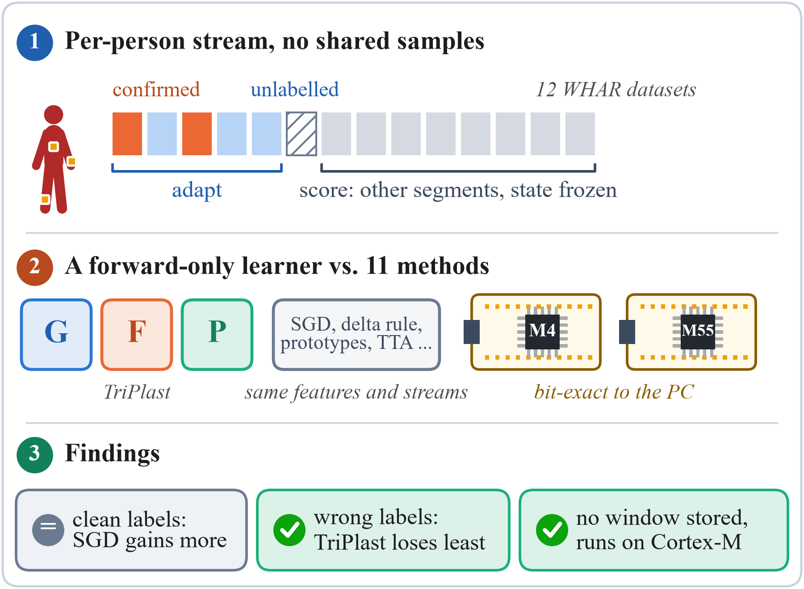
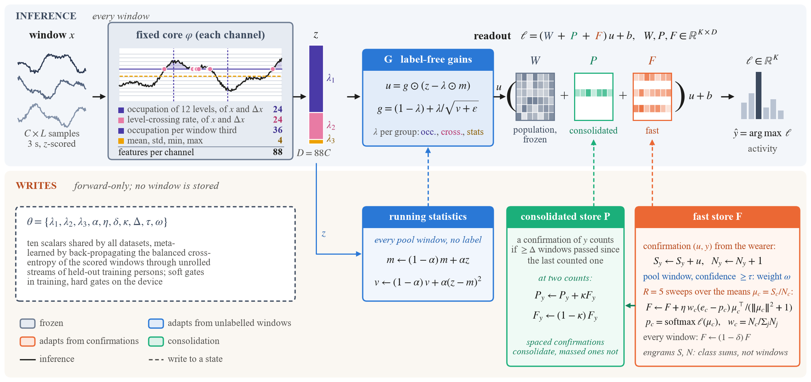
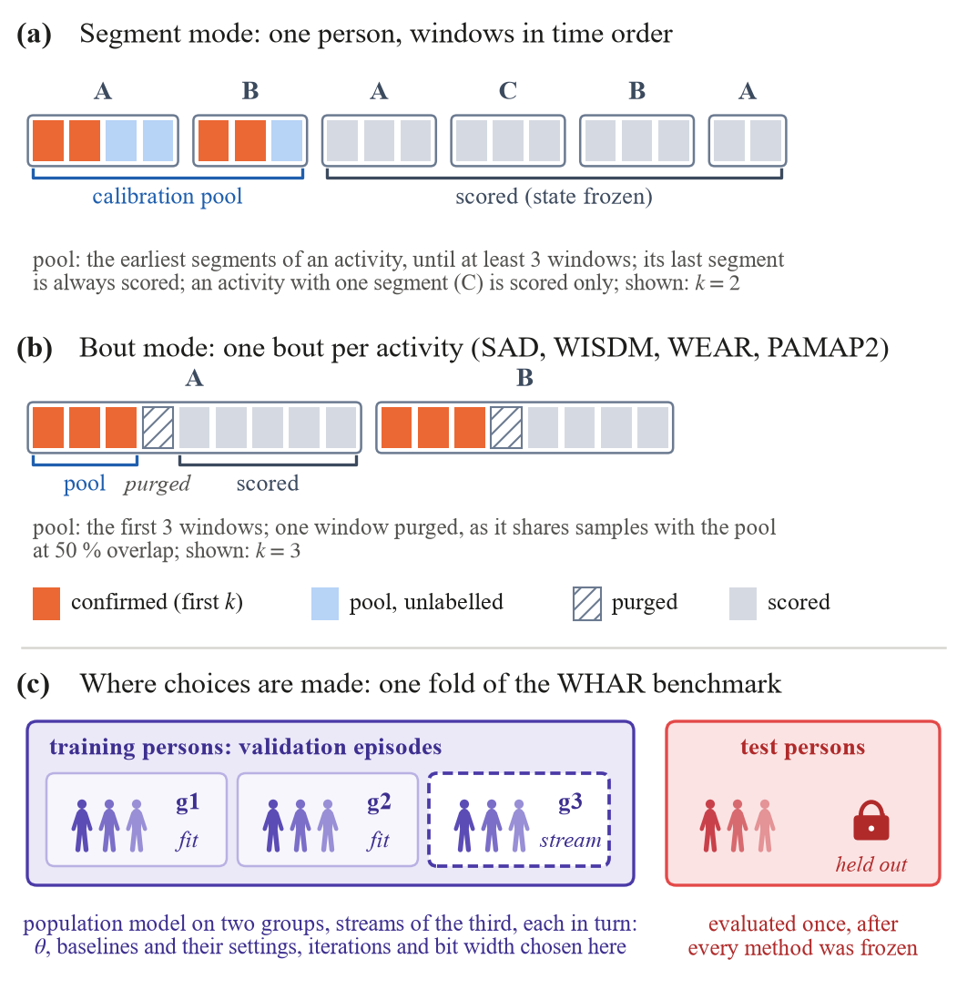
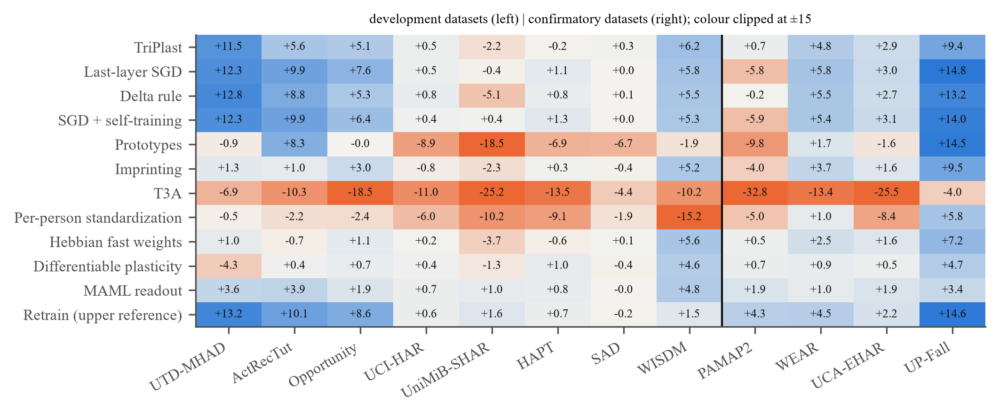
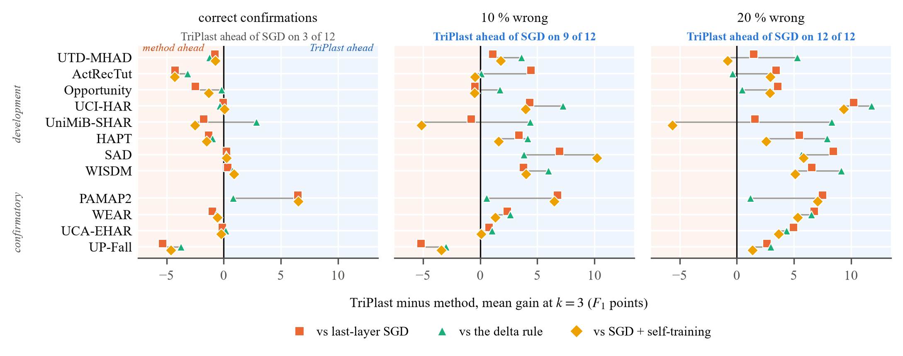
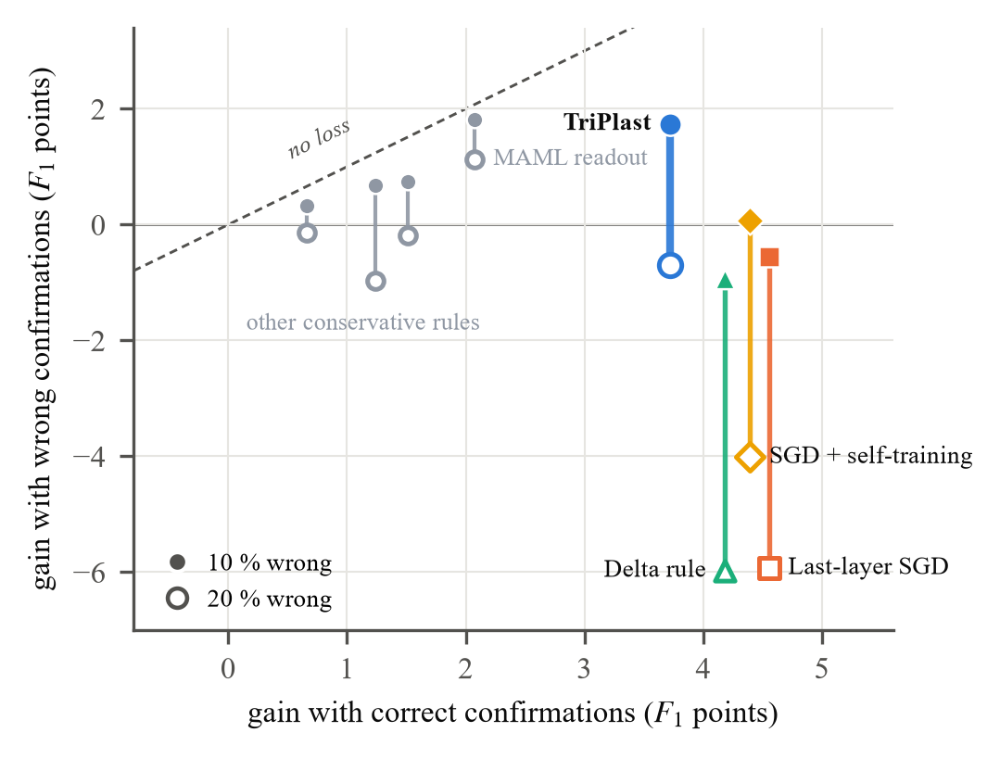

# TriPlast: forward-only wearer adaptation of activity recognizers on microcontrollers

> [!NOTE]
> **This is a preview repository.** The accompanying paper is under review. This repository currently holds only
> a summary of the method, the main results and a few core source files (see [Code](#code)). **The full code (Python
> library, experiment scripts, C99 core and STM32 firmware), run records, provenance files and the analysis plan with
> its amendments will be released in this repository once the paper is accepted.** Until then, please contact the
> author for questions.

## In short

A wearable activity recognizer trained on a population loses accuracy on a new wearer. It can be adapted on the
device from a few activities the wearer confirms, but confirmations can be wrong, and many published adaptation gains
come from protocols in which adaptation and scoring share recordings.

We compared **twelve adaptation methods on twelve datasets of the WHAR benchmark** under a per-person protocol in
which calibration and scored windows share no samples. Every choice was made on held-out training persons, and four
confirmatory datasets were held out until a single evaluation.

**TriPlast** is a meta-learned forward-only learner that keeps per-class feature sums instead of windows. It adds a
label-free gain `G`, a fast store `F` and a consolidated store `P` to a frozen population readout.

Main findings (test persons, k = 3 confirmations per activity, mean gain in macro-F1 points over the unadapted model):

| Condition | TriPlast | Last-layer SGD |
|---|---:|---:|
| Correct confirmations, 12 datasets | +3.72 | **+4.55** |
| 10 % of confirmations wrong, 12 datasets | **+1.74** | -0.56 |
| 20 % of confirmations wrong, 12 datasets | **-0.71** | -5.93 |
| Share of confirmatory persons harmed (correct confirmations) | **14 %** | 24 % |

- With correct confirmations, SGD gains more; the pre-registered advantage of TriPlast on the few-subject
  confirmatory dataset (PAMAP2) was **not** significant. We report this negative primary result as it is.
- With wrong confirmations the ranking reverses: with a fifth of them wrong, TriPlast is ahead of SGD on all twelve
  datasets (a descriptive comparison, computed after the test evaluation).
- TriPlast keeps no window, its state has a fixed size, and it runs in fixed point on Cortex-M4 and Cortex-M55
  microcontrollers with predictions **bit-identical** to the PC reference.

## Method

The population model is fixed: each window is mapped to 88 value-domain features per channel (level occupations,
level-crossing rates, occupations per window third, mean, standard deviation, minimum, maximum), and a class-balanced
logistic regression gives the readout `W, b`. TriPlast adapts it with three stores; the logits are
`(W + P + F) G(z) + b`.

- **`G` (label-free):** running mean and variance of the standardized features over the unlabelled calibration
  windows, with one meta-learned shrinkage per feature group (0 = unadapted, 1 = full per-person standardization).
- **`F` (fast store):** each confirmation is added to a per-class feature sum and count; no window is stored. A few
  error-gated delta sweeps run over the class means. Confident unlabelled windows join their predicted class with a
  small weight. A wrong confirmation is averaged with the correct ones of its class, so its weight shrinks.
- **`P` (consolidated store):** spaced confirmations move part of `F` into `P`.
- **Meta-learning:** ten scalars shared by all datasets, learned by backpropagating through unrolled per-person streams
  of validation episodes (training persons only, leave one dataset out).

## Protocol

- Data: the public WHAR benchmark datasets, in the code version of its paper (whar-datasets `144e006`, whar-models
  `9b65004`, whar-arena `19b3019`), with the benchmark's own population splits. No own data collection.
- Per-person stream: calibration pool (first `k` windows of each activity confirmed, the rest unlabelled) from the
  earliest segments; scoring on other segments (segment mode) or after a purged window (bout mode), with the state
  frozen. Every method sees the same stream and is scored on the same windows.
- Wrong confirmations: 10 % or 20 % of the confirmations at `k = 3` carry a label drawn from the other activities.
- Statistics: the person is the unit; paired Wilcoxon tests with Holm correction, bootstrap intervals over persons,
  and the share of persons harmed (gain below -0.5).
- Datasets: [`results/datasets.csv`](results/datasets.csv) (8 development, 4 confirmatory).

## Results

**Gain of every method on every dataset** (correct confirmations, k = 3):

**With wrong confirmations** (TriPlast minus each window-fitting rule, per dataset):

**Clean gain against gain with wrong labels:**

Absolute macro-F1 on the test persons (mean over twelve datasets; full table in
[`results/absolute_macro_f1.csv`](results/absolute_macro_f1.csv)):

| | Unadapted | SGD | Delta rule | TriPlast |
|---|---:|---:|---:|---:|
| Correct confirmations | 72.7 | **77.6** | 77.2 | 76.7 |
| 20 % wrong confirmations | | 66.0 | 66.2 | **71.8** |

On all test windows the fixed population model averages 72.7 macro-F1, against 69.3 for the median of the 17 WHAR
Arena models.

Per-dataset gains and harm shares on the confirmatory datasets:
[`results/confirmatory_gains_k3.csv`](results/confirmatory_gains_k3.csv) (format: mean gain (share of persons harmed)).

### On the microcontrollers

Replays of the confirmatory test persons on NUCLEO-L4R5ZI (Cortex-M4F, 120 MHz) and NUCLEO-N657X0-Q (Cortex-M55,
800 MHz, CPU only): frozen firmware, 8-bit stores, k = 3. All 64,539 replayed windows were bit-identical to the PC
fixed-point reference on each board and all state checksums matched.

| Board | Dataset | Scored window, median (ms) | Confirmation, max (ms) | RAM (KB) |
|---|---|---:|---:|---:|
| L4 (M4F, 120 MHz) | PAMAP2 | 21.0 | 219.9 | 285.2 |
| L4 (M4F, 120 MHz) | WEAR | 3.7 | 91.7 | 86.2 |
| L4 (M4F, 120 MHz) | UCA-EHAR | 1.5 | 21.2 | 38.8 |
| L4 (M4F, 120 MHz) | UP-Fall | 7.7 | 130.2 | 208.5 |
| N6 (M55, 800 MHz) | PAMAP2 | 2.9 | 32.0 | 285.2 |
| N6 (M55, 800 MHz) | WEAR | 0.5 | 13.8 | 86.2 |
| N6 (M55, 800 MHz) | UCA-EHAR | 0.2 | 2.9 | 38.8 |
| N6 (M55, 800 MHz) | UP-Fall | 1.1 | 19.5 | 208.5 |

Latency is measured with the DWT cycle counter; RAM is the static memory of the C core. Full table:
[`results/device_latency_ram.csv`](results/device_latency_ram.csv). No energy is reported (no measurement device was
used).

## Code

### Included in this preview

A few core files, copied unchanged from the project repository and placed at their paths in the full release:

| File | Content |
|---|---|
| [`src/models/triplast.py`](src/models/triplast.py) | TriPlast in PyTorch: `G`, `F`, `P`, rehearsal over class means and pseudo-labelled sums; a vectorized stream and a window-by-window reference |
| [`src/data/features.py`](src/data/features.py) | the fixed value-domain features (`level3+stats`, 88 per channel) |
| [`src/data/adapt_protocol.py`](src/data/adapt_protocol.py) | the leakage-free per-person split into calibration pool and scored windows (segment and bout mode) |
| [`src/evaluation/metrics.py`](src/evaluation/metrics.py) | macro-F1, gain and harm as reported |
| [`firmware/nucleo_l4r5zi_triplast/Core/Inc/tp_core.h`](firmware/nucleo_l4r5zi_triplast/Core/Inc/tp_core.h) | the interface of the C99 core that runs on the boards and serves as the PC fixed-point reference |

These files are provided for reading; they are not runnable on their own. References inside them to `docs/`,
`scripts/` and other modules point to files of the full release.

### Full code base (to be released after acceptance)

| Part | Content |
|---|---|
| `src/data/` | WHAR loading through the pinned benchmark code, per-person adaptation splits, value-domain features, population model |
| `src/models/triplast.py` | TriPlast (`G`, `F`, `P`), a vectorized stream and a window-by-window reference, tested against each other |
| `src/models/adaptation.py` | the eleven compared methods (per-person standardization, T3A, last-layer SGD, SGD + self-training, delta rule, imprinting, prototypes, Hebbian fast weights, differentiable plasticity, MAML readout, retraining reference) |
| `src/training/meta.py` | episodic meta-learning of TriPlast's parameters |
| `scripts/` | data preparation, validation runs, frozen test evaluation, analysis, figures, verification (re-execution, leakage tests, negative controls) |
| `firmware/` | STM32 firmware: one C99 core compiled for the boards and as a PC shared library (the fixed-point reference), UART replay protocol, DWT cycle counting |

Environment: Python 3.12, PyTorch (CUDA 12.6), the pinned WHAR code; firmware with Arm GNU 14.2, CMake and Ninja.
Every reported number carries a provenance record (producing command, commit, input and output hashes), and scripts
re-derive every number in the paper from the stored predictions and checkpoints.

## Citation

The citation will be added after acceptance.

## License

All rights reserved until the full release, including the source files in this preview. A license will be added
together with the full code.
